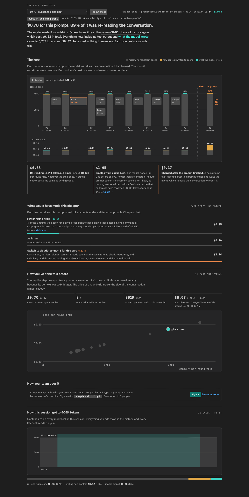

# PromptConduit

**See where every AI prompt's money goes.** Most of what an AI coding agent
costs isn't the work you asked for. It's the model re-reading the whole
conversation on every round-trip. The Loop shows that for each prompt, round-trip
by round-trip, tells you what would have been cheaper, and compares the run with
how you've done the same kind of task before.

Everything is computed on your machine from your local event log
(`~/.promptconduit/events.jsonl`). None of your code or prompts leave your device.
Works with **Claude Code** and **Cursor**.

## Install

**Cursor**: open the Extensions pane (`⇧⌘X` / `Ctrl+Shift+X`), search
**"PromptConduit"**, and click **Install**. Cursor installs from
[Open VSX](https://open-vsx.org/extension/promptconduit/promptconduit).

**VS Code**: install from the
[VS Code Marketplace](https://marketplace.visualstudio.com/items?itemName=promptconduit.promptconduit),
or run `code --install-extension promptconduit.promptconduit`.

The extension reads what the `promptconduit` CLI captures, so install that too.
See [Requirements](#requirements).

## The Loop



Click the cost in the status bar (or run **PromptConduit: Show The Loop**):

- **The headline.** What the prompt cost and how much of it was re-reading the
  conversation. For example: *"$0.70 for this prompt. 89% of it was re-reading
  the conversation."*
- **The loop.** One column per round-trip to the model, as tall as the
  conversation it read. The tools it ran sit between the columns, and each
  column's cost sits underneath. It replays when you open a prompt and grows
  live while a prompt runs.
- **What would have made this cheaper.** The same steps re-priced under other
  approaches: fewer round-trips, a fresh session or subagent, switching models
  (often more expensive than it sounds). Each links to a short guide.
- **Notes** on things that already happened: a long wait that outlived the
  prompt cache, or a background task that woke the agent after the prompt ended.
- **How you've done this before.** This run against your past prompts of the same
  kind (ship, debug, build, …): cost, round-trips and context size, with your
  cheapest run.
- **How your team does it.** The same comparison across teammates, in the web
  app (free for up to 3 people).
- **How this session got here.** Context size across the whole session, so you
  can see when it's worth starting fresh.

Pick any earlier prompt from the menu at the top. The panel follows the session
in your focused terminal or selected Cursor agent tab.

## Status bar

The bottom-right status bar shows `⚡ <last request> · 🕘 <session>` live. Its
tooltip includes this branch's and this PR's spend.

## Ask your agent

The `promptconduit` CLI includes an MCP server, so the agent in your editor can
answer *"what did my last prompt cost, and what would have been cheaper?"*
itself. The Loop shows whether it's registered with this editor's agent (Cursor
in Cursor, Claude Code in VS Code) and offers a one-click **Register** that runs
`promptconduit mcp install`. Signed-in users also get **Invite a teammate**. See
[promptconduit.dev/docs/agents](https://promptconduit.dev/docs/agents).

## Also in the terminal

The CLI serves the same view in your browser, for any editor or none:

```bash
promptconduit loop
```

## Requirements

Install the CLI:

```bash
curl -fsSL https://promptconduit.dev/install | bash
```

If it isn't on your `PATH`, set `promptconduit.cost.binaryPath`.

## Settings

| Setting | Default | Description |
|---|---|---|
| `promptconduit.cost.enabled` | `true` | Show the live cost item in the status bar. |
| `promptconduit.cost.binaryPath` | `""` | Override the CLI path (auto-detected otherwise). |
| `promptconduit.restore.mode` | `auto` | Reopen Claude Code sessions interrupted by an editor restart. |
| `promptconduit.cursorTabs.enabled` | `true` | Cursor only: follow the selected agent tab. |

## Develop

```bash
npm install
npm run compile        # or: npm run watch
npm run preview        # render The Loop with sample data in a browser
```

Press **F5** in VS Code / Cursor to launch an Extension Development Host, open a
folder where you run Claude Code or a Cursor agent, and watch the status bar update.

## Publishing

Targets: **Open VSX** (for Cursor) and the **VS Code Marketplace**.

Release: bump `version` in `package.json`, commit, then tag. The `Publish`
workflow publishes to Open VSX and the VS Code Marketplace (via trusted
publishing, so no Marketplace token is stored):

```bash
git tag v0.23.0 && git push origin v0.23.0
```

Or publish locally:

```bash
npm run package        # builds promptconduit-<version>.vsix
npm run publish:ovsx   # needs OVSX_TOKEN in env or `ovsx login`
npm run publish:vsce   # needs `vsce login promptconduit`
```
